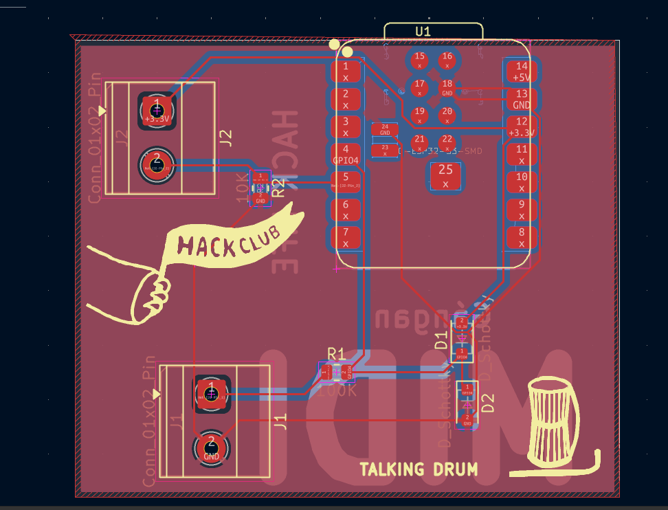
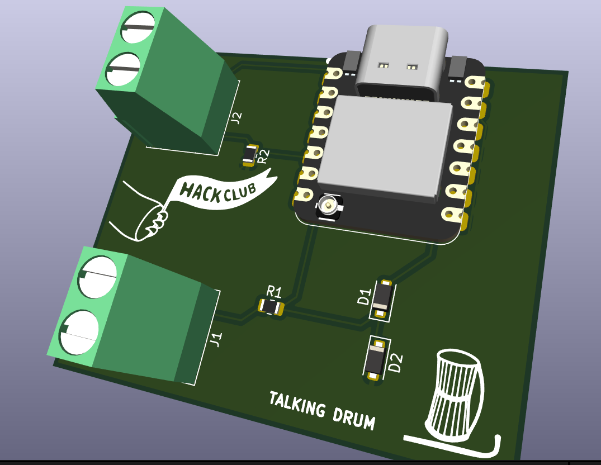

# MIDI-Instrument
**MIDI Talking Drum Controller**

I'm building a MIDI controller inspired by the traditional talking drum also known as Gángan.
The goal is to detect how hard the drum is struck and use applied pressure to control the pitch.

**Components**
1. Seeed Studio XIAO ESP32-S3 - Reads the sensors and sends MIDI messages to a computer.
2. Piezoelectric sensor - Detect strikes through vibration of the strike pad.
3. Force-sensitive resistor (FSR) - Detects pressure changes to control pitch.
4. 100 kΩ and 10 kΩ resistors - Piezo current limiting ans Forms a voltage divider with the FSR.
5. Schottky diodes - protects the circuit from voltage spikes.

**How It Works**
The piezo sensor detects strikes and determines MIDI velocity, the FSR measures pressure to control MIDI pitch bend. The XIAO ESP32-S3 processes the readings of the piezoelectric and FSR sensor and sends MIDI data over USB.

This is a learning project, so I'm figuring things out as I go and improving the design along the way!

